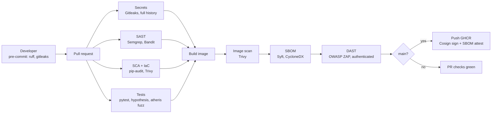
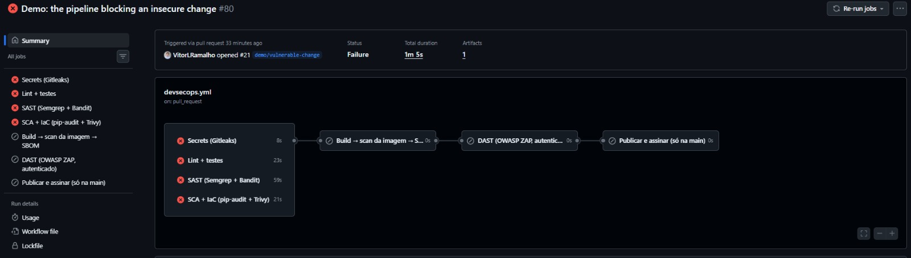
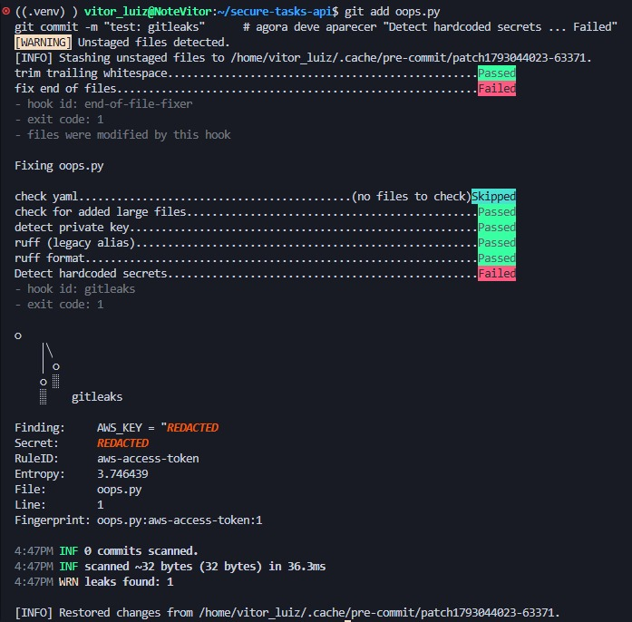
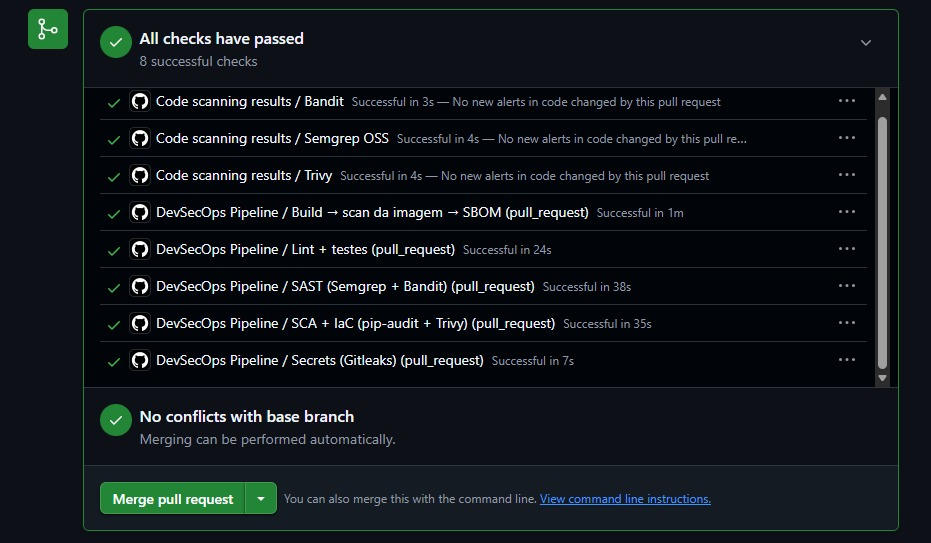
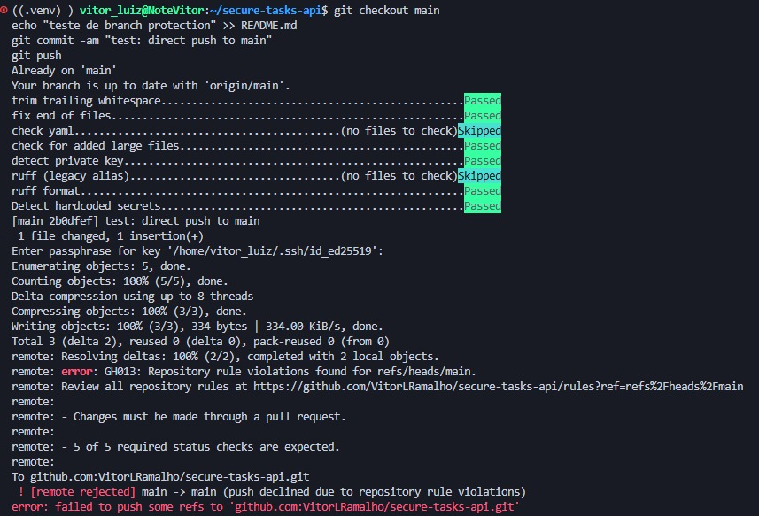

# Secure Tasks API — a reference DevSecOps pipeline

[](https://github.com/VitorLRamalho/secure-tasks-api/actions/workflows/devsecops.yml)
[](https://scorecard.dev/viewer/?uri=github.com/VitorLRamalho/secure-tasks-api)


[Leia em português](README.pt-BR.md)

A small FastAPI service (JWT auth, per-user tasks) wrapped in a GitHub Actions pipeline that
blocks insecure changes before they reach `main`: secrets scanning, SAST, SCA, IaC and container
scanning, fuzzing, authenticated DAST, SBOM, and keyless-signed images on every release.

> Built in three weeks as a portfolio project. Every finding the pipeline caught, and the decision
> taken for each, is in the [findings log](docs/findings.md). The [threat model](docs/threat-model.md)
> maps each STRIDE category to the control that covers it. To watch the gates work, see
> [the pipeline blocking an insecure change](#see-it-block-an-insecure-change).

## Pipeline at a glance



Static version: [docs/pipeline.png](docs/pipeline.png).

## What is enforced

| Stage | Threat | Tool | Gate |
| --- | --- | --- | --- |
| Secrets | credentials in any commit | Gitleaks, on pre-commit and in CI over the full history of the pull request | any finding |
| SAST | insecure code, mutable action references, hardcoded keys | Semgrep (OWASP Top 10, Python, secrets, Dockerfile) from the vendor image pinned by digest + Bandit | any Semgrep finding; Bandit medium+ |
| SCA | dependencies with known CVEs | pip-audit over hash-pinned requirements | any known CVE |
| IaC | insecure Dockerfile or config | Trivy misconfig | CRITICAL / HIGH |
| Tests + fuzzing | regressions, inputs that crash validation | pytest (coverage ≥ 80 %), hypothesis property tests, 30 s of atheris fuzzing on every PR | any failure or crash |
| Container | OS and library CVEs in the image | Trivy image scan | CRITICAL / HIGH with a fix available |
| DAST | runtime flaws (injection, headers, auth, error handling) | OWASP ZAP API scan, authenticated with a JWT, against the built image | rules marked FAIL in `zap/api-scan.conf` |
| Release | unverifiable artifacts | push to GHCR on `main` only, keyless Cosign signature, CycloneDX SBOM attestation | — |
| Supply chain | hijacked actions, stale dependencies | every action pinned to a commit SHA; Dependabot (7-day cooldown, minor/patch grouped, majors one PR at a time); OpenSSF Scorecard weekly | — |
| Exceptions | findings ignored silently | `.trivyignore`, `.gitleaksignore`, `nosemgrep`, ZAP `IGNORE`: every entry carries a reason and a review date | reviewed in the findings log |
| Governance | bypassing the pipeline | branch ruleset: PR required, 5 required checks, up to date with `main`, no force-push | enforced |

## See it block an insecure change

[Pull request #21](https://github.com/VitorLRamalho/secure-tasks-api/pull/21) opens with four
flaws made on purpose, one per gate, in a single commit (`6477b82`). Four jobs go red; build and
DAST never start. The following commits fix one flaw at a time, so the history shows each gate
releasing.

| Flaw | Caught by | Fixed in |
| --- | --- | --- |
| AWS-format access key hardcoded in `app/config.py` (randomly generated, never valid) | Gitleaks (pre-commit bypassed on purpose; CI caught it), Semgrep `p/secrets`, Trivy secret scanner | `9ae9359` — and the key stays in history, see below |
| `/tasks/search` building SQL with an f-string | Ruff S608, Bandit B608, Semgrep | `2a3ec93`, with the regression test `test_search_is_parameterized` |
| `jinja2==3.1.2`, a version with five known CVEs | pip-audit | `da97bb1` |
| Final image `FROM python:latest`, running as root | Trivy DS002, Semgrep `missing-user` | `dbcd3b5` |



Deleting the key was not enough: the secrets job scans every commit of the pull request, so it
stayed red after the fix. That is the point. In a real incident the credential is compromised the
moment it is pushed and has to be rotated; only then is the historical finding acknowledged by its
fingerprint in `.gitleaksignore`, with the reason and the date (`db99b1c`).

## Verify the published image

Anyone can check that the image in the registry is the one that passed every gate, and read
its SBOM, without trusting this repository:

```bash
IMAGE=ghcr.io/vitorlramalho/secure-tasks-api:latest
cosign verify "$IMAGE" \
  --certificate-identity-regexp 'https://github.com/VitorLRamalho/secure-tasks-api/' \
  --certificate-oidc-issuer https://token.actions.githubusercontent.com
cosign verify-attestation --type cyclonedx "$IMAGE" \
  --certificate-identity-regexp 'https://github.com/VitorLRamalho/secure-tasks-api/' \
  --certificate-oidc-issuer https://token.actions.githubusercontent.com
```

The certificate subject is this repository's workflow on `main`; the signature and the attestation
are recorded in the Sigstore transparency log, and the inclusion proof travels inside the bundle,
so verification works offline. Verified with Cosign 3.1.4.

## Evidence

**Gitleaks stopping a commit before it exists** (an AWS-format key, randomly generated for the test):



**All gates green on a pull request:**



**A direct push to `main` rejected by the ruleset:**



**OpenSSF Scorecard:** 7.5/10, 12 of 17 checks at 10. What stays low needs a second maintainer
(Code-Review, Branch-Protection) or time (Maintained), not code. Live report in the
[Scorecard viewer](https://scorecard.dev/viewer/?uri=github.com/VitorLRamalho/secure-tasks-api).

## What the DAST found

The authenticated ZAP scan found three real issues the static tools could not see; each was
fixed with a regression test (details in the [findings log](docs/findings.md)):

- a race between concurrent `DELETE` and `PUT` on the same task returned 500 (now 404);
- an unvalidated path parameter (`task_id`) above 64 bits returned 500 (now 422);
- the `Cross-Origin-Resource-Policy` header was missing.

The [threat model](docs/threat-model.md) maps each STRIDE category to the control that covers it,
the evidence, and what is still open.

## Run locally

```bash
python -m venv .venv && source .venv/bin/activate
pip install -r requirements.txt -r requirements-dev.txt
pre-commit install
cp .env.example .env            # then set APP_JWT_SECRET (32+ chars)
pytest                          # 15 tests, coverage >= 80%; 30 s of atheris fuzzing runs in CI
docker build --pull -t secure-tasks-api:dev .
docker run --rm -p 8000:8000 -e APP_ENV=dev -e APP_JWT_SECRET="$(openssl rand -hex 32)" secure-tasks-api:dev
```

## Known limitations and accepted risks

- Solo project: no second reviewer, so Scorecard's Code-Review and reviewer-based
  Branch-Protection checks stay low by design.
- SQLite; no rate limiting; no audit log. Rate limiting and body-size limits are expected from the
  reverse proxy in production.
- ZAP 40014 (`<script>` echoed inside a JSON response) is accepted: the API is JSON-only with
  `nosniff` and a `default-src 'none'` CSP. Review date 2026-12-01.
- Every accepted risk has a line in the [findings log](docs/findings.md) with a review date.

## Backlog

- Rate limiting on `/auth/login` (`slowapi`).
- Structured audit log.
- A signed semver release (`v1.0.0`), which also feeds Scorecard's Signed-Releases check.
- OpenSSF Best Practices badge.
