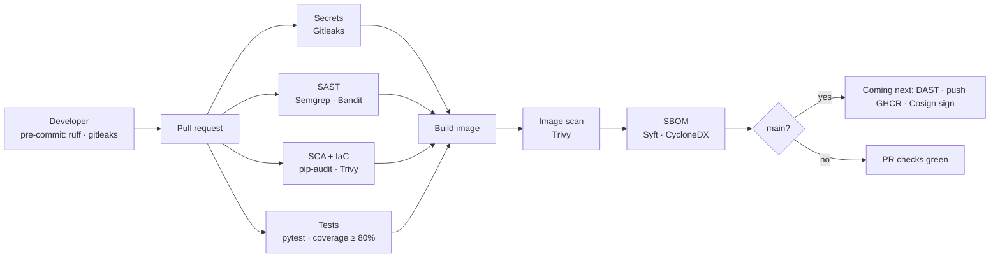

# Secure Tasks API — a reference DevSecOps pipeline

[](https://github.com/VitorLRamalho/secure-tasks-api/actions/workflows/devsecops.yml)


A small FastAPI service (JWT auth, per-user tasks) wrapped in a GitHub Actions pipeline that
blocks insecure changes before they reach `main`: secrets scanning, SAST, SCA, IaC and container
scanning and an SBOM on every build. Authenticated DAST and Cosign-signed images are next.

> Work in progress (week 2 of 3). Everything the pipeline has caught so far, with the decision
> taken for each, is in the [findings log](docs/findings.md).

## Pipeline at a glance



## What is enforced today

| Stage | Threat | Tool | Gate |
| --- | --- | --- | --- |
| Secrets | credentials in any commit | Gitleaks, on pre-commit and in CI over the full history | any finding |
| SAST | insecure code, mutable action references | Semgrep (OWASP Top 10, Python, secrets, Dockerfile) + Bandit | any Semgrep finding; Bandit medium+ |
| SCA | dependencies with known CVEs | pip-audit over hash-pinned requirements | any known CVE |
| IaC | insecure Dockerfile or config | Trivy misconfig | CRITICAL / HIGH |
| Container | OS and library CVEs in the image | Trivy image scan | CRITICAL / HIGH with a fix available |
| Supply chain | hijacked actions, unverifiable builds | every action pinned to a commit SHA; CycloneDX SBOM via Syft | — |
| Governance | bypassing the pipeline | branch ruleset: PR required, 5 required checks, no force-push | enforced |

## Evidence

**Gitleaks stopping a commit before it exists** (an AWS-format key, randomly generated for the test):


**All gates green on a pull request:**


**A direct push to `main` rejected by the ruleset:**


## Run locally

```bash
python -m venv .venv && source .venv/bin/activate
pip install -r requirements.txt -r requirements-dev.txt
pre-commit install
cp .env.example .env            # then set APP_JWT_SECRET (32+ chars)
pytest                          # 10 tests, coverage ≥ 80%
docker build --pull -t secure-tasks-api:dev .
docker run --rm -p 8000:8000 -e APP_ENV=dev -e APP_JWT_SECRET="$(openssl rand -hex 32)" secure-tasks-api:dev
```

## Roadmap (week 3)

- Authenticated DAST with OWASP ZAP against the built image
- Keyless image signing with Cosign and SBOM attestation on `main`
- OpenSSF Scorecard and Dependabot
- STRIDE threat model and a demo PR with intentionally insecure changes being blocked
