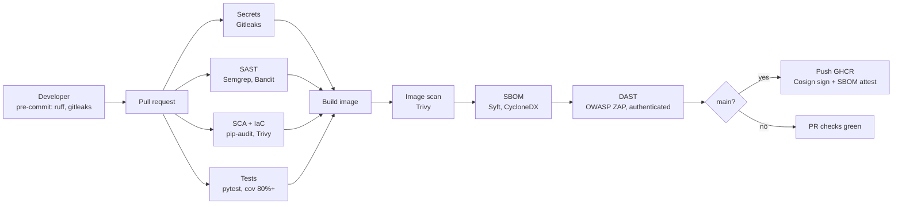
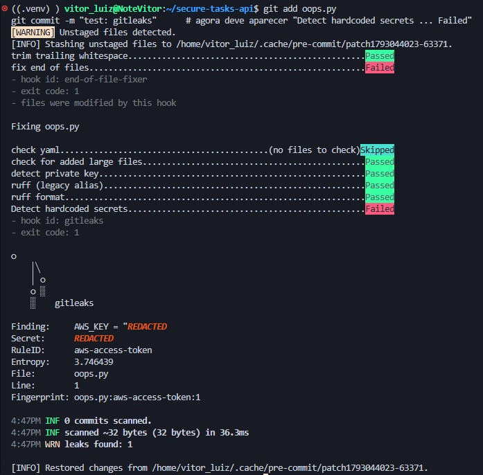
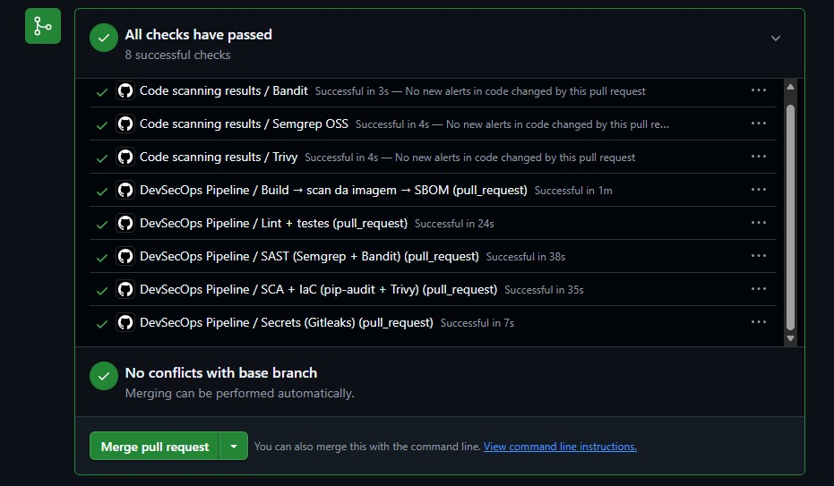
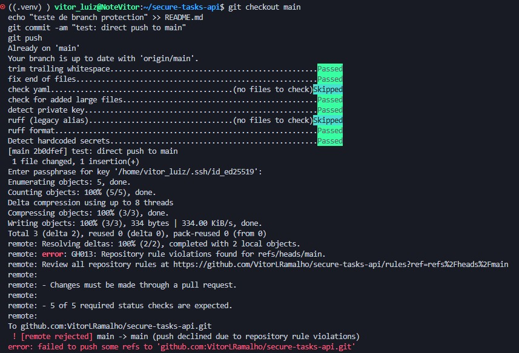

# Secure Tasks API — a reference DevSecOps pipeline

[](https://github.com/VitorLRamalho/secure-tasks-api/actions/workflows/devsecops.yml)
[](https://scorecard.dev/viewer/?uri=github.com/VitorLRamalho/secure-tasks-api)


A small FastAPI service (JWT auth, per-user tasks) wrapped in a GitHub Actions pipeline that
blocks insecure changes before they reach `main`: secrets scanning, SAST, SCA, IaC and container
scanning, authenticated DAST, SBOM, and keyless-signed images on every release.

> Week 3 of 3. Everything the pipeline has caught so far, with the decision taken for each,
> is in the [findings log](docs/findings.md).

## Pipeline at a glance



## What is enforced

| Stage | Threat | Tool | Gate |
| --- | --- | --- | --- |
| Secrets | credentials in any commit | Gitleaks, on pre-commit and in CI over the full history | any finding |
| SAST | insecure code, mutable action references | Semgrep (OWASP Top 10, Python, secrets, Dockerfile) + Bandit | any Semgrep finding; Bandit medium+ |
| SCA | dependencies with known CVEs | pip-audit over hash-pinned requirements | any known CVE |
| IaC | insecure Dockerfile or config | Trivy misconfig | CRITICAL / HIGH |
| Container | OS and library CVEs in the image | Trivy image scan | CRITICAL / HIGH with a fix available |
| DAST | runtime flaws (injection, headers, auth, error handling) | OWASP ZAP API scan, authenticated with a JWT, against the built image | rules marked FAIL in `zap/api-scan.conf` |
| Release | unverifiable artifacts | push to GHCR on `main` only, keyless Cosign signature, CycloneDX SBOM attestation | — |
| Supply chain | hijacked actions, stale dependencies | every action pinned to a commit SHA; Dependabot (7-day cooldown); OpenSSF Scorecard weekly | — |
| Governance | bypassing the pipeline | branch ruleset: PR required, 5 required checks, no force-push | enforced |

## Verify the published image

Anyone can check that the image in the registry is the one that passed every gate, and read
its SBOM, without trusting this repository:

```bash
IMAGE=ghcr.io/vitorlramalho/secure-tasks-api:latest
cosign verify "$IMAGE" \
  --certificate-identity-regexp 'https://github.com/VitorLRamalho/secure-tasks-api/' \
  --certificate-oidc-issuer https://token.actions.githubusercontent.com
cosign verify-attestation --type cyclonedx "$IMAGE" \
  --certificate-identity-regexp 'https://github.com/VitorLRamalho/secure-tasks-api/' \
  --certificate-oidc-issuer https://token.actions.githubusercontent.com
```

The certificate subject is this repository's workflow on `main`; the signature is recorded in
the Sigstore transparency log.

## Evidence

**Gitleaks stopping a commit before it exists** (an AWS-format key, randomly generated for the test):



**All gates green on a pull request:**



**A direct push to `main` rejected by the ruleset:**



## What the DAST found

The authenticated ZAP scan found three real issues the static tools could not see; each was
fixed with a regression test (details in the [findings log](docs/findings.md)):

- a race between concurrent `DELETE` and `PUT` on the same task returned 500 (now 404);
- an unvalidated path parameter (`task_id`) above 64 bits returned 500 (now 422);
- the `Cross-Origin-Resource-Policy` header was missing.

## Run locally

```bash
python -m venv .venv && source .venv/bin/activate
pip install -r requirements.txt -r requirements-dev.txt
pre-commit install
cp .env.example .env            # then set APP_JWT_SECRET (32+ chars)
pytest                          # 12 tests, coverage >= 80%
docker build --pull -t secure-tasks-api:dev .
docker run --rm -p 8000:8000 -e APP_ENV=dev -e APP_JWT_SECRET="$(openssl rand -hex 32)" secure-tasks-api:dev
```

## Known limitations

- Solo project: no second reviewer, so Scorecard's Code-Review and reviewer-based
  Branch-Protection checks stay low by design.
- SQLite; no rate limiting; no audit log. See the findings log for accepted risks and review dates.

## Remaining

- STRIDE threat model (`docs/threat-model.md`)
- A demo pull request with intentionally insecure changes being blocked by each gate
