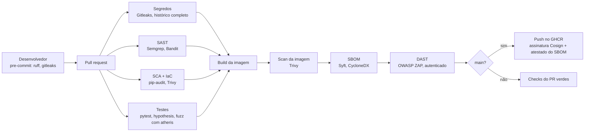
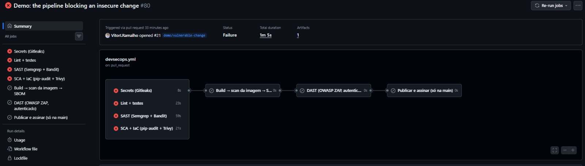
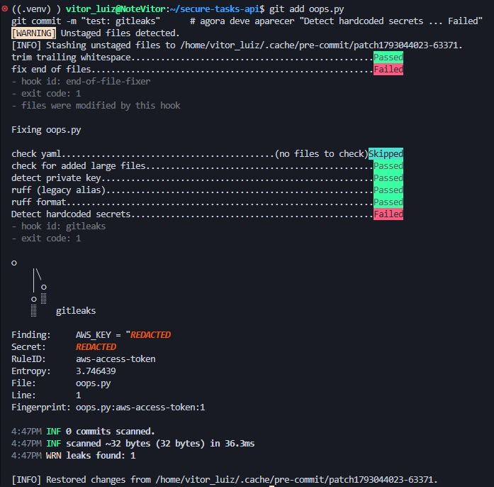
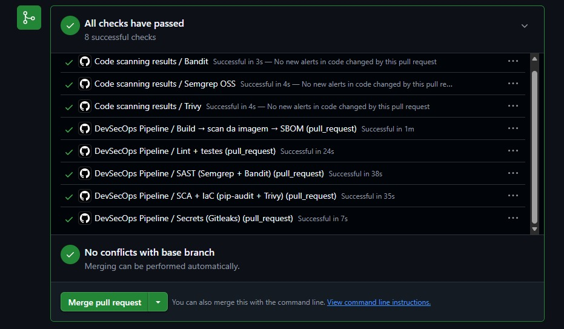
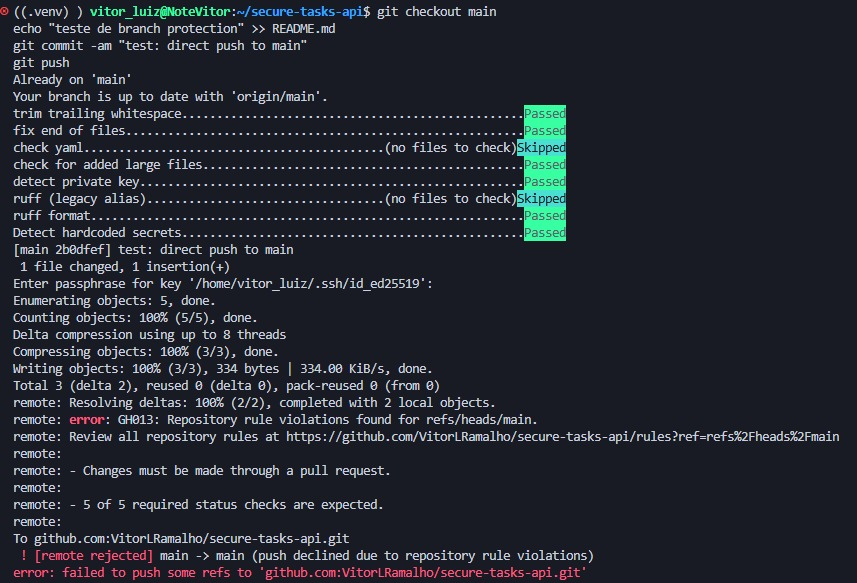

# Secure Tasks API — um pipeline DevSecOps de referência

[](https://github.com/VitorLRamalho/secure-tasks-api/actions/workflows/devsecops.yml)
[](https://scorecard.dev/viewer/?uri=github.com/VitorLRamalho/secure-tasks-api)


[Read in English](README.md)

Um serviço FastAPI pequeno (autenticação JWT, tarefas por usuário) envolvido por um pipeline de
GitHub Actions que bloqueia mudanças inseguras antes de chegarem à `main`: varredura de segredos,
SAST, SCA, IaC e varredura de container, fuzzing, DAST autenticado, SBOM e imagem assinada sem
chave a cada release.

> Construído em três semanas como projeto de portfólio. Tudo o que o pipeline pegou, e a decisão
> tomada para cada item, está no [registro de achados](docs/findings.md). O
> [modelo de ameaças](docs/threat-model.md) liga cada categoria STRIDE ao controle que a cobre. Para
> ver os gates em ação, veja [o pipeline bloqueando uma mudança insegura](#veja-o-pipeline-bloquear-uma-mudança-insegura).

## O pipeline em um olhar



Versão estática: [docs/pipeline.png](docs/pipeline.png).

## O que é imposto

| Etapa | Ameaça | Ferramenta | Gate |
| --- | --- | --- | --- |
| Segredos | credenciais em qualquer commit | Gitleaks, no pre-commit e no CI sobre o histórico completo do pull request | qualquer achado |
| SAST | código inseguro, referências mutáveis a actions, chaves no código | Semgrep (OWASP Top 10, Python, segredos, Dockerfile) rodando da imagem do fornecedor fixada por digest + Bandit | qualquer achado do Semgrep; Bandit medium ou acima |
| SCA | dependências com CVEs conhecidas | pip-audit sobre requirements fixados com hash | qualquer CVE conhecida |
| IaC | Dockerfile ou configuração insegura | Trivy misconfig | CRITICAL / HIGH |
| Testes + fuzzing | regressões, entradas que derrubam a validação | pytest (cobertura ≥ 80 %), testes de propriedade com hypothesis, 30 s de fuzzing com atheris em todo PR | qualquer falha ou crash |
| Container | CVEs do sistema e de bibliotecas na imagem | scan de imagem do Trivy | CRITICAL / HIGH com correção disponível |
| DAST | falhas em tempo de execução (injeção, headers, autenticação, tratamento de erro) | OWASP ZAP API scan, autenticado com JWT, contra a imagem construída | regras marcadas como FAIL em `zap/api-scan.conf` |
| Release | artefatos não verificáveis | push no GHCR só a partir da `main`, assinatura Cosign sem chave, atestado de SBOM CycloneDX | — |
| Cadeia de suprimentos | actions sequestradas, dependências desatualizadas | toda action fixada por SHA de commit; Dependabot (cooldown de 7 dias, minor/patch agrupados, majors um PR por vez); OpenSSF Scorecard semanal | — |
| Exceções | achados ignorados em silêncio | `.trivyignore`, `.gitleaksignore`, `nosemgrep`, `IGNORE` do ZAP: toda entrada tem motivo e data de revisão | revisadas no registro de achados |
| Governança | contornar o pipeline | ruleset da branch: PR obrigatório, 5 checks obrigatórios, atualizada com a `main`, sem force-push | aplicado |

## Veja o pipeline bloquear uma mudança insegura

O [pull request #21](https://github.com/VitorLRamalho/secure-tasks-api/pull/21) abre com quatro
falhas feitas de propósito, uma por gate, em um único commit (`6477b82`). Quatro jobs ficam
vermelhos; build e DAST nem começam. Os commits seguintes corrigem uma falha por vez, e o
histórico mostra cada gate liberando.

| Falha | Quem pegou | Corrigida em |
| --- | --- | --- |
| Chave de acesso no formato AWS escrita em `app/config.py` (gerada ao acaso, nunca foi válida) | Gitleaks (pre-commit pulado de propósito; o CI pegou), Semgrep `p/secrets`, scanner de segredos do Trivy | `9ae9359`, e a chave continua no histórico; veja abaixo |
| `/tasks/search` montando SQL com f-string | Ruff S608, Bandit B608, Semgrep | `2a3ec93`, com o teste de regressão `test_search_is_parameterized` |
| `jinja2==3.1.2`, versão com cinco CVEs conhecidas | pip-audit | `da97bb1` |
| Imagem final `FROM python:latest`, rodando como root | Trivy DS002, Semgrep `missing-user` | `dbcd3b5` |



Apagar a chave não bastou: o job de segredos varre todos os commits do pull request, então
continuou vermelho depois da correção. Esse é o ponto. Em um incidente real a credencial está
comprometida no instante em que é enviada e precisa ser rotacionada; só então o achado histórico é
reconhecido pelo seu fingerprint no `.gitleaksignore`, com o motivo e a data (`db99b1c`).

## Verifique a imagem publicada

Qualquer pessoa pode conferir que a imagem no registry é a que passou por todos os gates, e ler
o SBOM dela, sem confiar neste repositório:

```bash
IMAGE=ghcr.io/vitorlramalho/secure-tasks-api:latest
cosign verify "$IMAGE" \
  --certificate-identity-regexp 'https://github.com/VitorLRamalho/secure-tasks-api/' \
  --certificate-oidc-issuer https://token.actions.githubusercontent.com
cosign verify-attestation --type cyclonedx "$IMAGE" \
  --certificate-identity-regexp 'https://github.com/VitorLRamalho/secure-tasks-api/' \
  --certificate-oidc-issuer https://token.actions.githubusercontent.com
```

O subject do certificado é o workflow deste repositório na `main`; a assinatura e o atestado ficam
registrados no log de transparência do Sigstore, e a prova de inclusão viaja dentro do bundle, por
isso a verificação funciona offline. Verificado com Cosign 3.1.4.

## Evidências

**Gitleaks barrando um commit antes de ele existir** (uma chave no formato AWS, gerada ao acaso para o teste):



**Todos os gates verdes em um pull request:**



**Um push direto na `main` rejeitado pelo ruleset:**



**OpenSSF Scorecard:** 7.5/10, 12 de 17 checks em 10. O que fica baixo precisa de um segundo
mantenedor (Code-Review, Branch-Protection) ou de tempo (Maintained), não de código. Relatório ao
vivo no [visualizador do Scorecard](https://scorecard.dev/viewer/?uri=github.com/VitorLRamalho/secure-tasks-api).

## O que o DAST encontrou

O scan autenticado do ZAP encontrou três problemas reais que as ferramentas estáticas não
enxergavam; cada um foi corrigido com teste de regressão (detalhes no
[registro de achados](docs/findings.md)):

- uma corrida entre `DELETE` e `PUT` simultâneos na mesma tarefa devolvia 500 (hoje 404);
- um parâmetro de rota sem validação (`task_id`) acima de 64 bits devolvia 500 (hoje 422);
- o header `Cross-Origin-Resource-Policy` estava ausente.

O [modelo de ameaças](docs/threat-model.md) liga cada categoria STRIDE ao controle que a cobre, à
evidência e ao que ainda está em aberto.

## Rodando localmente

```bash
python -m venv .venv && source .venv/bin/activate
pip install -r requirements.txt -r requirements-dev.txt
pre-commit install
cp .env.example .env            # depois defina APP_JWT_SECRET (32+ caracteres)
pytest                          # 15 testes, cobertura >= 80%; 30 s de fuzzing com atheris rodam no CI
docker build --pull -t secure-tasks-api:dev .
docker run --rm -p 8000:8000 -e APP_ENV=dev -e APP_JWT_SECRET="$(openssl rand -hex 32)" secure-tasks-api:dev
```

## Limitações conhecidas e riscos aceitos

- Projeto solo: sem segundo revisor, então os checks Code-Review e Branch-Protection (na parte que
  depende de revisores) do Scorecard ficam baixos por definição.
- SQLite; sem rate limiting; sem log de auditoria. Rate limiting e limite de tamanho de body ficam a
  cargo do proxy reverso em produção.
- ZAP 40014 (`<script>` ecoado dentro de uma resposta JSON) é aceito: a API é só JSON, com
  `nosniff` e CSP `default-src 'none'`. Data de revisão: 2026-12-01.
- Todo risco aceito tem uma linha no [registro de achados](docs/findings.md) com data de revisão.

## Backlog

- Rate limiting em `/auth/login` (`slowapi`).
- Log de auditoria estruturado.
- Uma release semver assinada (`v1.0.0`), que também alimenta o check Signed-Releases do Scorecard.
- Badge OpenSSF Best Practices.
